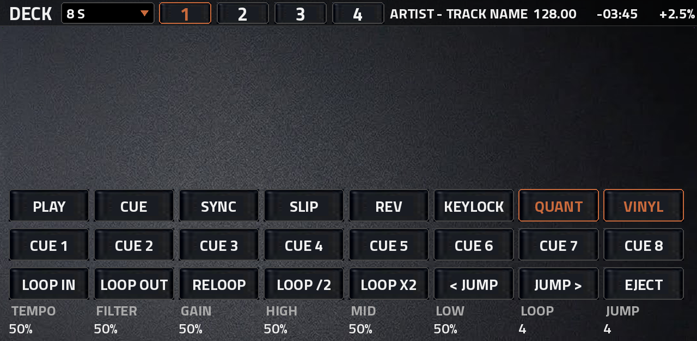
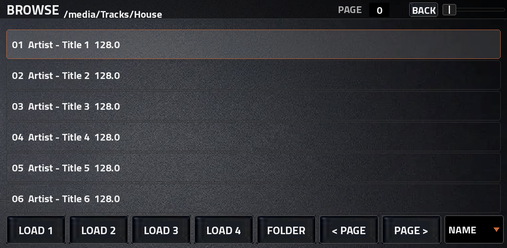
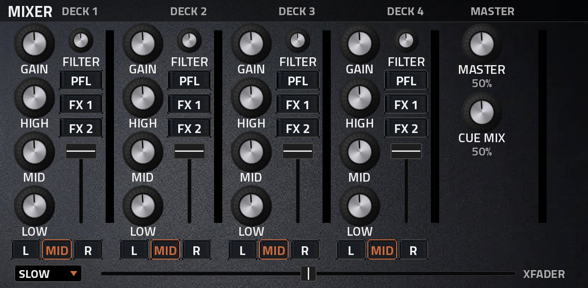
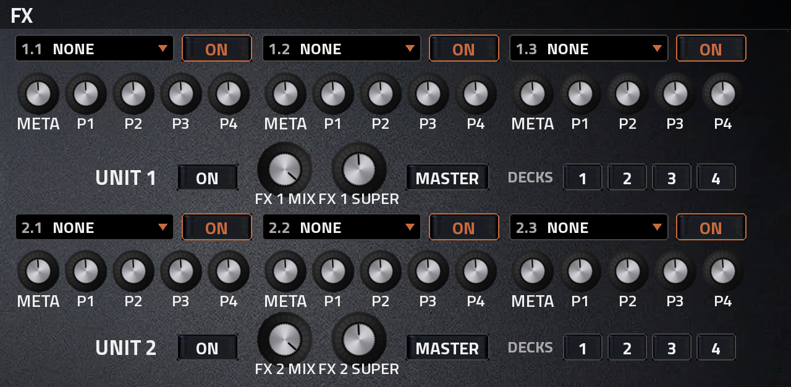
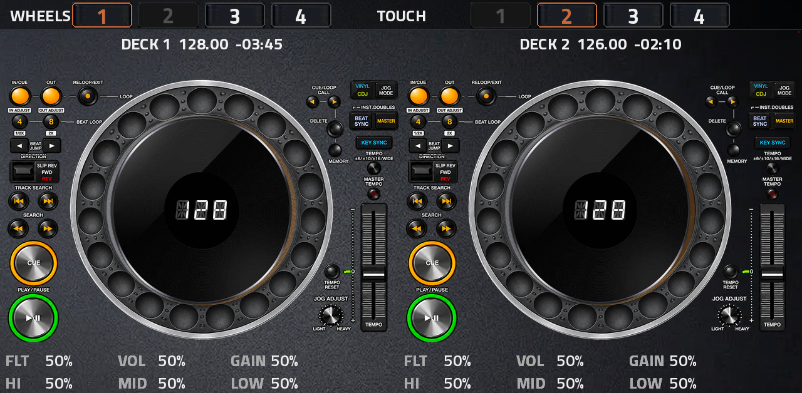
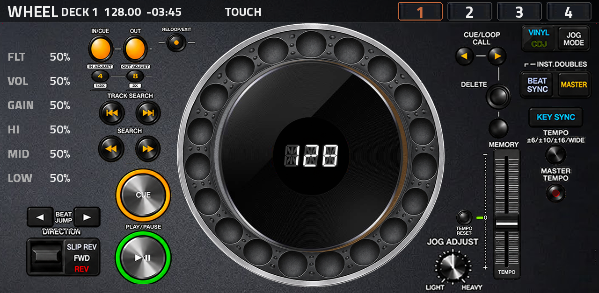

# reMixXXL

**Status: 0.1.15 (release). The last version tested on an Akai Force (MPC OS 3.9.1) by the author and recorded in `tested.json` is 0.1.12: new WHEEL page layout from the author's own art; wheel touch (also on a stopped track), ring spin, BPM digits, QR and the companion page work.** Four DJ decks for the Akai Force / MPC OS, as a native
plugin (VST2 for MPC's own plugin host, packed by [mpc-vst-plugins](https://github.com/sd88me/mpc-vst-plugins)).
By L'Cronx.

reMixXXL follows [Mixxx](https://mixxx.org): its control names (`[Channel1],play`, `hotcue_1_activate`,
`beatloop_4_activate`, `rate` ...), its deck model (cue, hot cues, beat loops, beat jump, slip, keylock, sync, vinyl
mode), its mixer (gain, three-band EQ, quick-effect filter, PFL, crossfader orientation), its effect units (two units
of three slots each, with meta knobs and a super knob) and its controller mappings (`<name>.midi.xml` + the
`-scripts.js` files, run by QuickJS with Mixxx's `engine.*` / `midi.*` script API). It is not a port of Mixxx's code:
the audio engine, decoding, analysis, screen and touch handling are reMixXXL's own C, written for the Force.

## Pages

MPC's plugin screen (1280 x 628 under the MPC header) has these tabs (the OVERVIEW page was removed in 0.1.2; the plugin starts on DECK):

| tab | what |
|---|---|
| DECK | the selected deck: Mixxx-style scrolling waveform and overview strip (the live overlay), three rows of CDJ-style buttons (PLAY CUE SYNC SLIP REV KEYLOCK QUANT VINYL / hot cues 1-8 / LOOP IN, LOOP OUT, RELOOP, LOOP /2, LOOP X2, < JUMP, JUMP >, EJECT), the ZOOM popup, title / BPM / time / tempo readouts. Q-Link banks DECK 1..4: tempo, filter, gain, high, mid, low, loop size, jump size, zoom |
| BROWSE | the track list: six rows a page, LOAD 1-4, FOLDER, < PAGE, PAGE >, a SORT popup (NAME / BPM / ARTIST); the path and the page number in the stripe, a SCROLL fader. Q-Links: scroll, select, page, sort |
| MIXER | four channel strips (GAIN, HIGH, MID, LOW, FILTER knobs that turn in place; PFL, FX 1, FX 2; a volume fader; a VU meter; L / MID / R crossfader side), MASTER and CUE MIX, the crossfader. Q-Link banks MIXER 1 (volumes + filters), 2 (gains + highs), 3 (mids + lows), MASTER |
| FX | both effect units: three slots each (effect popup, ON, META and four parameter knobs named by the effect), and per unit ON, MIX, SUPER, MASTER and the deck enables 1 2 3 4. Q-Link banks FX 1, FX 2 (metas, mix, super), FX 1 PARAMS, FX 2 PARAMS |
| WHEELS | two CDJ-style decks side by side, built from the user's CDJ photo (`art/platter_nobrand.png`, `art/control_map.json`): the platter, cue, play, the tempo fader, tempo reset, master tempo, tempo range, beat loop 4 / 8, loop in / out, beat jump, slip / rev, track search, search, jog feel, vinyl / jog mode, beat sync / master, key sync. DECK 1-4 buttons per side pick which deck each wheel drives. Q-Link banks WHEELS 1..4 |
| WHEEL | one CDJ deck, full size (the left wheel's deck), laid out from the author's own transparent art (0.1.11): loop in / out / reloop, beat loop 4 / 8, track search, search, cue, play, beat jump, direction (slip / rev), vinyl / jog mode, beat sync / master, key sync, tempo range, master tempo, the tempo fader and its scale, tempo reset, the JOG ADJUST knob. The deck's filter, volume, gain, high, mid and low show as values on the left. Q-Link banks WHEEL 1..4 |

## Screenshots (0.1.12)

The pages as the skin draws them (1280 x 628). WHEEL is the 0.1.12 layout, from the author's own art; the others are rendered by `./build.sh --skin-only`.

| DECK | BROWSE |
|---|---|
|  |  |
| **MIXER** | **FX** |
|  |  |
| **WHEELS** | **WHEEL** |
|  |  |

## The wheel (WHEEL and WHEELS pages)

- The ring picture (24 dimples) is a film strip the engine turns with the platter; the black centre plate, the light/shadow
  overlay and the three BPM digits (DSEG14, "BAZZLINE" look) sit on top and do not spin.
- A finger anywhere on the wheel works it, in any direction (angle round the centre): VINYL mode spins/scratches the
  track, CDJ mode nudges the pitch, scaled by JOG ADJUST. The ring picture follows.
- On the single WHEEL page the small black centre circle toggles the companion page's QR code (SHOW QR).
- MASTER TEMPO's lamp blinks with the master deck's beat. On WHEELS each side picks its deck with DECK 1-4; the deck on the
  other side is greyed.

## Companion web page (phone or PC)

A small web server inside the plugin (port 6731, the next free port above it if taken) serves a page with the waveforms
of 1-4 decks, a spin/pitch box per deck, SELECT, ZOOM and a full-screen dot. Open `http://<the Force's IP>:6731/`, or scan
the QR code on the WHEEL page. See [docs/COMPANION.md](docs/COMPANION.md).

## Build

`./build.sh` builds the ARMv7 plugin with Zig (cross-compile) and the skin; `./tools/package.sh` makes the release zip
(`reMixXXL-<version>-mpc-armv7.zip`, packed by the mpc-vst-plugins wrapper in `third_party/`). `./build.sh --skin-only`
rebuilds only the skin. Never build x86/desktop versions: only the Force binary is supported.

**What this source reproduces.** `src/` builds the exact `remixxxl.so` of the 0.1.12 release (SHA-256 `00a9bafa62dd...b60c0`; it is
checked against this source's build). The release's skin differs from what `tools/remix_skin.py` generates in two ways that are
not in this source yet: 48 extra "jog knob" components in `TUI.json` and the ring film strips in reverse frame order
(`rx_jog_ring_*.png`). The 0.1.11/0.1.12 WHEEL page is the 0.1.10 skin run through `tools/patch_wheel.py` (the author's transparent picture
`art/ui/controls/wheel_page_user_0.1.11.png`, the boxes in `tools/wheel_geom.py`); the script reproduces the release's skin file for file. Use the release zip for the tested skin.

Text sizes follow the L'Cronx XXL rule: Titillium Web, nothing under 26 px on any page (readouts and list rows 26 px
Bold, button labels 28 px, page names and deck numbers 34 px, knob names 26-28 px SemiBold).

## MIDI and the MC3000 mapping

0.1.13 (test build): the MAPS page loads any controller map from `Mappings`, and the map builder page (`http://<Force IP>:6731/map`) makes a map for any controller. How: [docs/MAP_BUILDER.md](docs/MAP_BUILDER.md).

All MIDI that reaches the plugin's track goes to the engine (no CC / NRPN by the wrapper). The `Mappings` folder of
the plugin holds Mixxx controller mappings; `Denon MC3000.midi.xml` + `Denon-MC3000-scripts.js` (with
`common-controller-scripts.js` and `lodash.mixxx.js`) ship as the first one. Pick a mapping with the MIDI MAP
parameter; MIDI LEARN maps any incoming CC / note to the control last touched (saved next to the plugin). Any other
Mixxx mapping can be dropped into `Mappings`; what its script needs of Mixxx's API and is not yet implemented is
written to the diag log.

## Known limits

- Stopped or paused track: turning the wheel moves the playhead (0.1.10; one turn is about 1.8 s of track).
- Not done yet: the deck left/right buttons do nothing; no separate cue/headphone output; no per-deck outputs (whether MPC
  routes a plugin's extra outputs is unverified); waveforms are not drawn on the Force screen itself in this release.

- Key detection is not in the analyzer yet (KEY shows nothing; KEY SYNC does nothing until a key is known).
- AIFF files are not decoded (WAV, FLAC, MP3 are).
- The platter centre still shows the label from the photo (`Screen/platter_frames.png`); it is meant to be replaced.
- The printed labels on the wheel parts are the photo's own (small); the text rule applies to everything live. To be
  settled after the first device test.
- LED feedback to a controller needs the plugin's ALSA port ("reMixXXL: LED Out") routed in MPC's MIDI settings; not
  yet verified on a device.

## Logs

Two text files next to the plugin, for reporting a problem:

- `remixxxl_diag.log`: the engine's timestamped log (start-up, track loads, analysis, mappings, MIDI learn, every
  touch event on the wheel pages: rate, down / up, slots).
- `remixxxl_overlay.log`: the overlay program (the live screen): the display plane it found, the page markers it
  sees, why it is not drawing.

## Install

Take the release zip (`reMixXXL-<version>-mpc-armv7.zip` from the Releases page), unzip it on a computer, connect the
Force (SSH as in the mpc-vst-plugins docs) and run `install.sh`; `uninstall.sh` removes it. `INSTALL.md` in the zip
has the steps, `SHA256SUMS` the checksums. The plugin folder is `L'Cronx - VST - reMixXXL` (the apostrophe is part of
the name and is escaped in the scripts). Put tracks (WAV / FLAC / MP3) into its `Tracks` folder, or pick any folder on
BROWSE.

## Build

`./build.sh` (needs python3 with Pillow and numpy, a host gcc, and Zig via `pip install ziglang`); `./build.sh
--skin-only` builds and checks only the skin and writes `build/preview/<page>.png` for every page. The ARM `.so` is
built with Zig for armv7-a / glibc 2.31; the skin from `tools/remix_skin.py`; the geometry of every page from
`tools/remix_pages.py` (`build/pages.json`, shipped as `Layout/pages.json` with numbered overlays of the wheel
pages). Only the Force (ARM) binary is built; there is no desktop build.

## Licences

reMixXXL is GPL-3.0-or-later (see `LICENSE`). Third-party parts:

- Mixxx designs, control names, controller mappings and scripts: GPL-2.0-or-later (Mixxx Development Team).
- qm-dsp (beat tracking, key detection): GPL (Queen Mary, University of London); `third_party/qm-dsp/COPYING`.
- QuickJS: MIT (Fabrice Bellard, Charlie Gordon and contributors); `third_party/quickjs/LICENSE`.
- dr_libs (dr_wav, dr_flac): public domain / MIT-0 (David Reid).
- minimp3: CC0 (lieff).
- stb (stb_image, stb_truetype): public domain / MIT (Sean Barrett).
- Titillium Web: SIL Open Font License 1.1 (Accademia di Belle Arti di Urbino); `Fonts/OFL.txt`.
- mpc-vst-plugins (the wrapper, the skin and release tools): MIT (sd88me); `third_party/mpc-vst-plugins/LICENSE`.

The CDJ photo and panel texture in `art/` are the user's own material, used as supplied.

## UI editor

The pages are laid out in a browser editor (`tools/dump_editor.py` + `tools/make_editor.py` build it from the real
pages; `tools/ui_editor_template.html` is the editor). It saves a layout file, `art/ui/reMixXXL_layout.json`, which
`tools/ui_layout.py` applies to the skin: positions, deletions, the user's own knob picture (`art/ui/knob.png`), and added
buttons and readouts (what each drives is listed in `art/ui/bindings.json`). Nothing is placed by the build itself.
