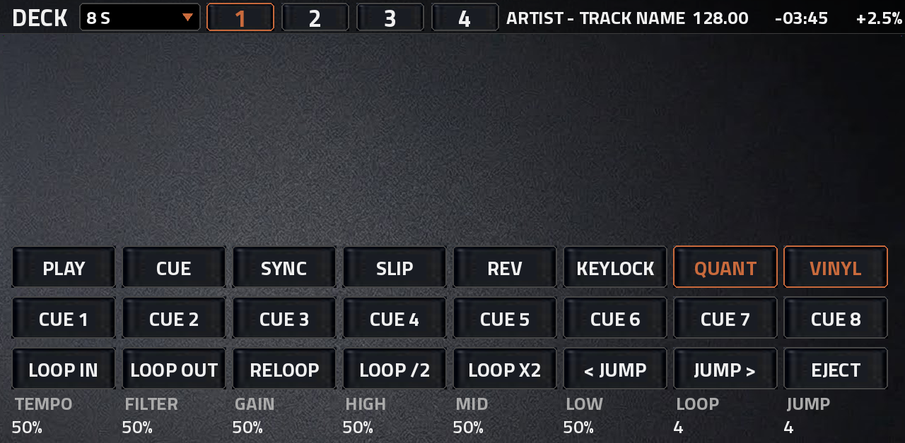
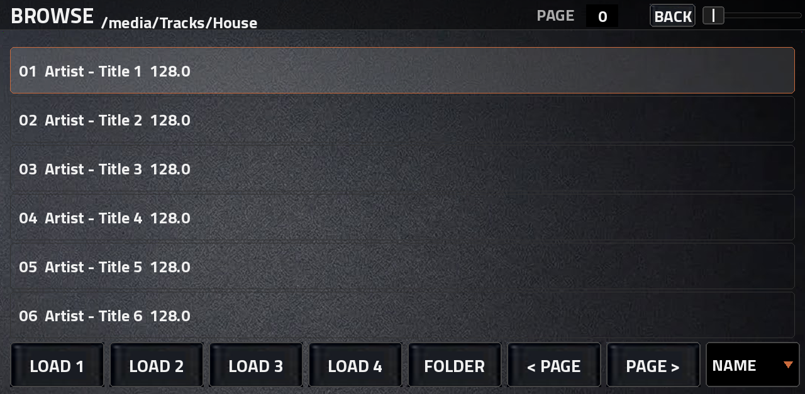
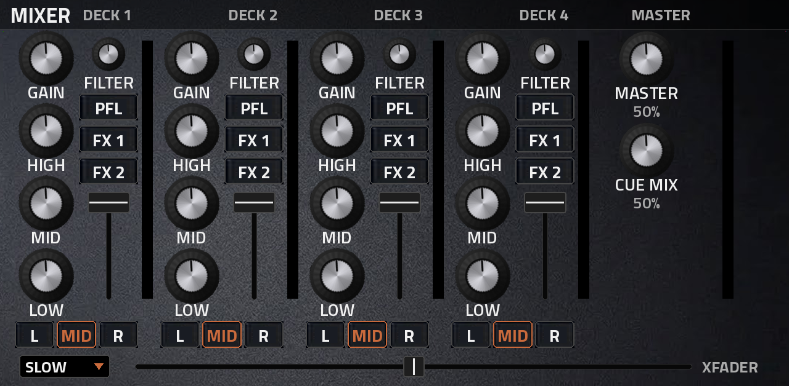
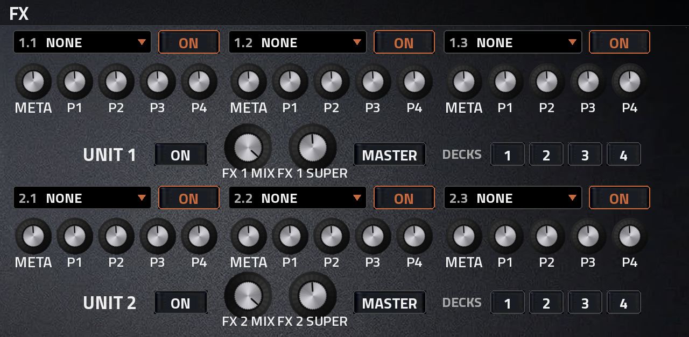
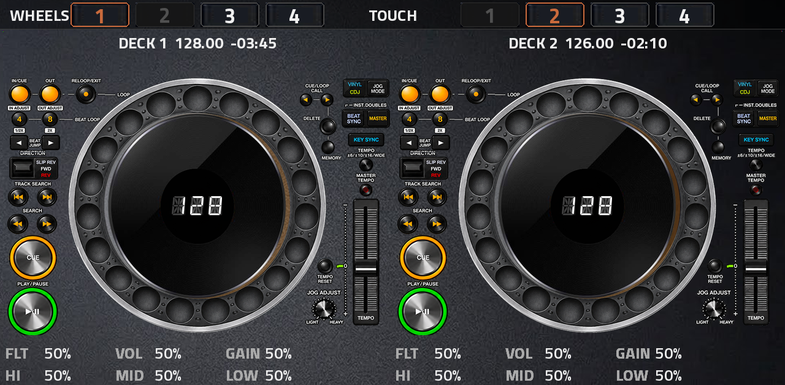
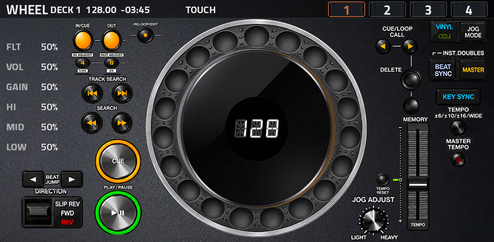

# reMixXXL

**Status: 0.2.0 (pre-release: built and tested offline on 2026-11-17, not tried on a device yet). New: reMixXXL and reMixXXL CUE also for the 64-bit MPCs (Gen2: Live III, XL, One G2, Key G2) and for MPC OS 3.10.1, three zips each (armv7, aarch64, sdk); the code is 0.1.25's, which was tested on an Akai Force (MPC OS 3.9.1, by the author; recorded in `tested.json`). Since 0.1.23: a cue (PFL) for beat matching. Outputs 1/2 are the main mix; a deck with PFL on leaves the mix and is heard only on outputs 3/4 (the headphones), decks 1/3 left and 2/4 right, through the small companion effect reMixXXL CUE; each deck has its own PFL level knob (PFL 1-4). How to route it: [Cue (PFL)](#cue-pfl-beat-matching-on-the-headphones).** Four DJ decks for the Akai Force / MPC OS, as a native
plugin (VST2 for MPC's own plugin host, packed with the [Open MPC](https://github.com/open-mpc/mpc-vst-plugins) release tools).
By L'Cronx.

reMixXXL follows [Mixxx](https://mixxx.org): its control names (`[Channel1],play`, `hotcue_1_activate`,
`beatloop_4_activate`, `rate` ...), its deck model (cue, hot cues, beat loops, beat jump, slip, keylock, sync, vinyl
mode), its mixer (gain, three-band EQ, quick-effect filter, PFL, crossfader orientation), its effect units (two units
of three slots each, with meta knobs and a super knob) and its controller mappings (`<name>.midi.xml` + the
`-scripts.js` files, run by QuickJS with Mixxx's `engine.*` / `midi.*` script API). It is not a port of Mixxx's code:
the audio engine, decoding, analysis, screen and touch handling are reMixXXL's own C, written for the Force.

## Pages

MPC's plugin screen (1280 x 628 under the MPC header) has these tabs (the OVERVIEW page was removed in 0.1.2; the plugin starts on DECK):

| tab | what |
|---|---|
| DECK | the selected deck: Mixxx-style scrolling waveform and overview strip (the live overlay), three rows of CDJ-style buttons (PLAY CUE SYNC SLIP REV KEYLOCK QUANT VINYL / hot cues 1-8 / LOOP IN, LOOP OUT, RELOOP, LOOP /2, LOOP X2, < JUMP, JUMP >, EJECT), the ZOOM popup, title / BPM / time / tempo readouts. Q-Link banks DECK 1..4: tempo, filter, gain, high, mid, low, loop size, jump size, zoom |
| BROWSE | the track list: six rows a page, LOAD 1-4, FOLDER, < PAGE, PAGE >, a SORT popup (NAME / BPM / ARTIST); the path and the page number in the stripe, a SCROLL fader. Q-Links: scroll, select, page, sort |
| MIXER | four channel strips (GAIN, HIGH, MID, LOW, FILTER knobs that turn in place; PFL, FX 1, FX 2; a volume fader; a VU meter; L / MID / R crossfader side), MASTER and CUE MIX, the PFL 1-4 cue levels, the crossfader. Q-Link banks MIXER 1 (volumes + filters), 2 (gains + highs), 3 (mids + lows), MASTER |
| FX | both effect units: three slots each (effect popup, ON, META and four parameter knobs named by the effect), and per unit ON, MIX, SUPER, MASTER and the deck enables 1 2 3 4. Q-Link banks FX 1, FX 2 (metas, mix, super), FX 1 PARAMS, FX 2 PARAMS |
| WHEELS | two CDJ-style decks side by side, built from the user's CDJ photo (`art/platter_nobrand.png`, `art/control_map.json`): the platter, cue, play, the tempo fader, tempo reset, master tempo, tempo range, beat loop 4 / 8, loop in / out, beat jump, slip / rev, track search, search, jog feel, vinyl / jog mode, beat sync / master, key sync. DECK 1-4 buttons per side pick which deck each wheel drives. Q-Link banks WHEELS 1..4 |
| WHEEL | one CDJ deck, full size (the left wheel's deck), laid out from the author's own transparent art (0.1.11): loop in / out / reloop, beat loop 4 / 8, track search, search, cue, play, beat jump, direction (slip / rev), vinyl / jog mode, beat sync / master, key sync, tempo range, master tempo, the tempo fader and its scale, tempo reset, the JOG ADJUST knob. The deck's filter, volume, gain, high, mid and low show as values on the left. Q-Link banks WHEEL 1..4 |

## Screenshots (0.2.0)

The pages as the skin draws them (1280 x 628). All pages are rendered from the 0.2.0 skin by `./build.sh --skin-only` (pixel-identical to the 0.1.25 images: the skin did not change); the WHEEL page's right-hand column is the author's own art.

| DECK | BROWSE |
|---|---|
|  |  |
| **MIXER** | **FX** |
|  |  |
| **WHEELS** | **WHEEL** |
|  |  |

## Cue (PFL): beat matching on the headphones

reMixXXL makes two separate signals from one plugin: **outputs 1/2 are the mix to the main outs**, and the **cue (PFL) goes to outputs 3/4, which you listen to on the headphones jack**. MPC's plugin host only plays the first stereo pair of a plugin, so the cue leaves through a small companion effect, **reMixXXL CUE**, that sits on an audio track.

### What you hear where

| | what it carries |
|---|---|
| **Outputs 1/2 (main)** | the full mix of the decks **without** any deck that has PFL on. A deck with PFL on is taken out of the main mix, so the room never hears it. |
| **Outputs 3/4 (headphones)** | only the decks with PFL on. **Decks 1 and 3 on the LEFT, decks 2 and 4 on the RIGHT**, so you can hear one deck in each ear and beat match. With no PFL on, the cue is silent. |

The cue is taken after each deck's gain, EQ, filter and effects but **before the channel fader and crossfader**: a deck with its fader all the way down is still heard at full level in the cue. That is what lets you cue and beat match a track before you bring it in.

### Volume: where the monitoring is controlled

The monitoring volume is set on the knobs in the plugin, not on the main faders:

- **PFL 1, PFL 2, PFL 3, PFL 4** (MIXER page, under CUE MIX; also Q-Link / automation): each deck's own level in the cue. 50% is normal level, up is louder. Use them to balance the two ears while beat matching.
- The **CUE MIX** knob on the MIXER page is a Mixxx control kept for controller maps; it does not change the cue on 3/4.
- **CUE LEVEL** (on the reMixXXL CUE screen): the overall level of the whole cue output.
- The headphones jack's own volume on the Force still applies on top.

The main mix on 1/2 is not touched by any of these knobs: the main faders, crossfader and MASTER knob control 1/2 only.

### Set-up, step by step

1. **Install both plugins** on the MPC (see [Install](#install): reMixXXL and reMixXXL CUE from the catalog, or the two zips for your device, each with its own `install.sh`): `reMixXXL-<version>-mpc-armv7.zip` (or `-aarch64`, or `-sdk`) and `reMixXXL-CUE-<version>-mpc-armv7.zip` (or `-aarch64`, or `-sdk`). Restart MPC so both plugins appear.
2. **Track A: reMixXXL.** Load **reMixXXL** on a track as the instrument. Leave that track's output on the main outputs (**1/2**). Do **not** put reMixXXL CUE on this track: the effect replaces the audio of the track it sits on with the cue.
3. **Track B: the cue track.** Make a separate **audio track**. In its effect slot load **reMixXXL CUE**. This track needs no recording and no input: the effect makes its own sound from reMixXXL's cue.
4. **Route track B to outputs 3/4**: set that audio track's output to **3/4** (not Main), so none of the cue reaches 1/2.
5. **Headphones:** set the Force so the headphones jack plays outputs 3/4 (MPC's audio output / headphone settings; the exact menu name depends on your MPC OS version). Now the headphones play the cue and the main outs play the mix.
6. Load tracks on the decks, press **PFL** on a deck (MIXER page, or the deck's PFL button): the deck disappears from 1/2 and you hear it in the headphones: deck 1 and 3 on the left, 2 and 4 on the right. Adjust with the PFL knobs.

Both plugins must be running in MPC at the same time (they talk through a small shared buffer in memory). The order they were loaded in does not matter. The cue has about 9 ms of delay (a small cushion), which does not matter for beat matching.

### The STATUS line on reMixXXL CUE

The CUE screen shows what it is doing:

| STATUS | meaning |
|---|---|
| WAITING: EFFECT NOT RUN YET | the track has not started processing yet: press play in MPC |
| NO RING FILE | the shared buffer could not be created (should not happen) |
| reMixXXL NOT RUNNING | reMixXXL is not loaded or has not started: load it on a track and press play |
| reMixXXL STOPPED | reMixXXL stopped being processed (its track is muted or MPC is stopped) |
| NO PFL ON (SILENT) | everything works; press PFL on a deck |
| PLAYING THE CUE | the cue is playing |

### Troubleshooting

- **You hear the cue on the main outs (1/2):** reMixXXL CUE is on the reMixXXL track, or the cue track is still routed to Main. Move CUE to its own audio track and set that track's output to 3/4.
- **Nothing in the headphones:** read the STATUS line; check the headphones are set to outputs 3/4; check the PFL knob is not at zero.
- **A deck is in both the main mix and the cue:** its PFL button is off; with PFL on it leaves the main mix.

## The wheel (WHEEL and WHEELS pages)

- The ring picture (24 dimples) is a film strip the engine turns with the platter; the black centre plate, the light/shadow
  overlay and the three BPM digits (DSEG14, "BAZZLINE" look) sit on top and do not spin.
- A finger anywhere on the wheel works it, in any direction (angle round the centre): VINYL mode spins/scratches the
  track, CDJ mode nudges the pitch, scaled by JOG ADJUST. The ring picture follows.
- On the single WHEEL page the small black centre circle toggles the companion page's QR code (SHOW QR).
- MASTER TEMPO's lamp blinks with the master deck's beat. On WHEELS each side picks its deck with DECK 1-4; the deck on the
  other side is greyed.

## Companion web page (phone or PC)

A small web server inside the plugin (port 6731, the next free port above it if taken) serves a page with the waveforms
of 1-4 decks, a spin/pitch box per deck, SELECT, ZOOM and a full-screen dot. Open `http://<the Force's IP>:6731/`, or scan
the QR code on the WHEEL page. See [docs/COMPANION.md](docs/COMPANION.md).

## Build

`./build.sh` builds reMixXXL for both CPUs with Zig (cross-compile, glibc 2.31): `build/arm/remixxxl.so` (armv7: the Force and the 32-bit
MPCs) and `build/arm64/remixxxl.so` (aarch64: the 64-bit MPCs), and the skin. `./cue/build.sh` does the same for reMixXXL CUE.
`./tools/package.sh` makes the six release zips in `dist/` (reMixXXL and reMixXXL CUE, each `-mpc-armv7.zip`, `-mpc-aarch64.zip` and
`-mpc-sdk.zip`) with the open-mpc release tools in `third_party/open-mpc-release/`. `./build.sh --skin-only` rebuilds only the skin.
`test/arm_sim.sh` runs the offline tests as ARM code, 32-bit and 64-bit, under qemu-user. Never build x86/desktop versions: only the
ARM binaries are supported. GitHub Actions (`.github/workflows/build.yml`) does all of this and publishes the release zips.

**What this source reproduces.** `src/` is the code of the 0.1.25 release (tested on a Force; its armv7 `remixxxl.so` has the SHA-256 `c54ac2d86c47b042b61bc049fe455145d74e424da131df1b3c70b1abad86cc39`) with only the version string changed for 0.2.0, which is built for both CPUs; `./build.sh` generates its skin; the WHEEL page is cut from the author's own picture `art/ui/controls/wheel_page_user_0.1.11.png` (boxes in `tools/wheel_geom.py`). The release zips of 0.1.25 and the earlier versions (`reMixXXL-0.1.25-mpc-armv7.zip`, `reMixXXL-CUE-0.1.3-mpc-armv7.zip`, ...) stay in the repo root; the 0.2.0 zips are on the Releases page, not in the repo.

Text sizes follow the L'Cronx XXL rule: Titillium Web, nothing under 26 px on any page (readouts and list rows 26 px
Bold, button labels 28 px, page names and deck numbers 34 px, knob names 26-28 px SemiBold).

## MIDI and the MC3000 mapping

0.1.13 (test build): the MAPS page loads any controller map from `Mappings`, and the map builder page (`http://<Force IP>:6731/map`) makes a map for any controller. How: [docs/MAP_BUILDER.md](docs/MAP_BUILDER.md).


All MIDI that reaches the plugin's track goes to the engine (no CC / NRPN by the wrapper). The `Mappings` folder of
the plugin holds Mixxx controller mappings; `Denon MC3000.midi.xml` + `Denon-MC3000-scripts.js` (with
`common-controller-scripts.js` and `lodash.mixxx.js`) ship as the first one. Pick a mapping with the MIDI MAP
parameter; MIDI LEARN maps any incoming CC / note to the control last touched (saved next to the plugin). Any other
Mixxx mapping can be dropped into `Mappings`; what its script needs of Mixxx's API and is not yet implemented is
written to the diag log.

## Known limits

- Stopped or paused track: turning the wheel moves the playhead (0.1.10; one turn is about 1.8 s of track).
- Not done yet: the deck left/right buttons do nothing; no separate cue/headphone output; no per-deck outputs (whether MPC
  routes a plugin's extra outputs is unverified); waveforms are not drawn on the Force screen itself in this release.

- Key detection is not in the analyzer yet (KEY shows nothing; KEY SYNC does nothing until a key is known).
- AIFF files are not decoded (WAV, FLAC, MP3 are).
- The platter centre still shows the label from the photo (`Screen/platter_frames.png`); it is meant to be replaced.
- The printed labels on the wheel parts are the photo's own (small); the text rule applies to everything live. To be
  settled after the first device test.
- LED feedback to a controller needs the plugin's ALSA port ("reMixXXL: LED Out") routed in MPC's MIDI settings; not
  yet verified on a device.
- 0.2.0 has not been tried on a device yet: the 64-bit MPCs (the wheel drawing on their screen, touch, the cue on outputs 3/4, MIDI) and
  MPC OS 3.10.1 are built and tested offline only (as ARM code under qemu), 2026-11-17. The code is the 0.1.25 code that was tested on a
  Force.

## Logs

Two text files next to the plugin, for reporting a problem:

- `remixxxl_diag.log`: the engine's timestamped log (start-up, track loads, analysis, mappings, MIDI learn, every
  touch event on the wheel pages: rate, down / up, slots).
- `remixxxl_overlay.log`: the overlay program (the live screen): the display plane it found, the page markers it
  sees, why it is not drawing.

## Install

Requirements: an **Akai Force** or a first-generation standalone MPC (MPC Live / Live II, One, X, Key 61 / 37) on **MPC OS 3.x**
(32-bit ARM: the `-mpc-armv7.zip`), or a 64-bit MPC (**MPC Live III, XL, One G2, Key G2**: the `-mpc-aarch64.zip`). The skin needs 3.x.
The two zips with `install.sh` need a **root shell (SSH)**, a modded unit (for example MockbaMod); on **MPC OS 3.10.1 or later** the
`-mpc-sdk.zip` (Akai's plugin folder format) needs no mod at all. Nothing else: the decoders, the analysis and the web page are inside
the plugin.

Each release has three zips for reMixXXL and three for the companion effect reMixXXL CUE (the cue needs both, see
[Cue (PFL)](#cue-pfl-beat-matching-on-the-headphones)). Pick the one for your device:

| Zip | For |
|---|---|
| `reMixXXL-<version>-mpc-armv7.zip` | Akai Force and the 32-bit MPCs (X, Live, Live II, One, Key 61 / 37), modded, MPC OS 3.x |
| `reMixXXL-<version>-mpc-aarch64.zip` | the 64-bit MPCs (Live III, XL, One G2, Key G2), modded, MPC OS 3.x |
| `reMixXXL-<version>-mpc-sdk.zip` | any MPC on **MPC OS 3.10.1 or later**, Akai's plugin folder format, no mod needed |
| `reMixXXL-CUE-<version>-mpc-armv7.zip`, `-mpc-aarch64.zip`, `-mpc-sdk.zip` | the same three, for the cue effect |

**With the Plugin Manager** (the [Open MPC catalog](https://open-mpc.github.io/mpc-vst-plugins/)): DISCOVER → reMixXXL → INSTALL →
APPLY, then the same for reMixXXL CUE. It picks the right zip for the device.

**One line, on the device** (needs internet; save your project first, MPC restarts). Force and 32-bit MPCs:

```sh
cd /tmp && wget -qO rx.zip https://github.com/sunskiefer/reMixXXL/releases/download/v0.2.0/reMixXXL-0.2.0-mpc-armv7.zip && unzip -qo rx.zip && sh reMixXXL-0.2.0/install.sh
```

64-bit MPCs: the same line with `-mpc-aarch64.zip` in place of `-mpc-armv7.zip`.

**From a computer:** download the release zip for your device, unzip it, copy the folder to the device and run its `install.sh`:

```sh
scp -r reMixXXL-0.2.0 root@<device-ip>:/tmp/
ssh root@<device-ip> sh /tmp/reMixXXL-0.2.0/install.sh
```

The installer checks the device, copies the plugin folder to `/sdcard/Synths/`, backs up `MPC.settings`, registers the plugin and
restarts MPC. Running it again upgrades and keeps your `Tracks` folder. `uninstall.sh` removes it. `INSTALL.md` in the zip has the manual
steps, `SHA256SUMS` the checksums. The plugin folder is `L'Cronx - VST - reMixXXL` (the apostrophe is part of the name and is escaped in
the scripts). Put tracks (WAV / FLAC / MP3) into its `Tracks` folder, or pick any folder on BROWSE.

**MPC OS 3.10.1 or later, Akai's format (no mod, no shell):** unzip `reMixXXL-<version>-mpc-sdk.zip` on a computer, copy its one folder
(`L'Cronx - VST - reMixXXL`, with `plugin.json` and both binaries inside) into the `VST2 Plugins` folder of a USB drive or SD card, put the
drive in the MPC, turn on **External Plugin Support** in the preferences and let MPC scan. The same folder works on the 32-bit and the
64-bit MPCs. Do the same with the reMixXXL CUE zip for the cue.

## Building from source

`./build.sh` (needs python3 with Pillow and numpy, a host gcc, and Zig via `pip install ziglang`); `./build.sh
--skin-only` builds and checks only the skin and writes `build/preview/<page>.png` for every page. The `.so` files are
built with Zig, armv7-a and aarch64, both for glibc 2.31; the skin from `tools/remix_skin.py`; the geometry of every page from
`tools/remix_pages.py` (`build/pages.json`, shipped as `Layout/pages.json` with numbered overlays of the wheel
pages). Only ARM binaries are built (the Force and 32-bit MPCs, and the 64-bit MPCs); there is no desktop build.

## Licences

reMixXXL is GPL-3.0-or-later (see `LICENSE`). Third-party parts:

- Mixxx designs, control names, controller mappings and scripts: GPL-2.0-or-later (Mixxx Development Team).
- qm-dsp (beat tracking, key detection): GPL (Queen Mary, University of London); `third_party/qm-dsp/COPYING`.
- QuickJS: MIT (Fabrice Bellard, Charlie Gordon and contributors); `third_party/quickjs/LICENSE`.
- dr_libs (dr_wav, dr_flac): public domain / MIT-0 (David Reid).
- minimp3: CC0 (lieff).
- stb (stb_image, stb_truetype): public domain / MIT (Sean Barrett).
- Titillium Web: SIL Open Font License 1.1 (Accademia di Belle Arti di Urbino); `Fonts/OFL.txt`.
- mpc-vst-plugins (the wrapper, the skin and release tools): MIT (sd88me); `third_party/mpc-vst-plugins/LICENSE`.

The CDJ photo and panel texture in `art/` are the user's own material, used as supplied.

## UI editor

The pages are laid out in a browser editor (`tools/dump_editor.py` + `tools/make_editor.py` build it from the real
pages; `tools/ui_editor_template.html` is the editor). It saves a layout file, `art/ui/reMixXXL_layout.json`, which
`tools/ui_layout.py` applies to the skin: positions, deletions, the user's own knob picture (`art/ui/knob.png`), and added
buttons and readouts (what each drives is listed in `art/ui/bindings.json`). Nothing is placed by the build itself.
